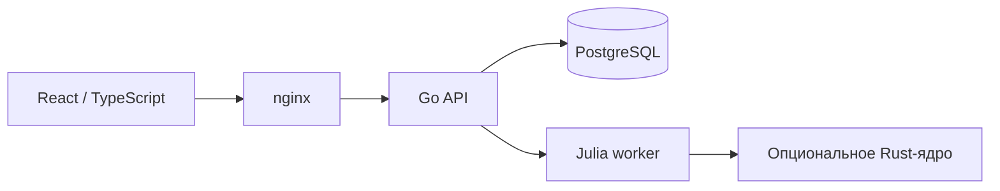

# Enersy

Открытая платформа моделирования энергосистем: редактор схем, общий каталог, проекты и версии исследований, развиваемое вычислительное ядро.

На 2026-10-25 поддержан экспериментальный симметричный установившийся AC-режим. Проверены аналитические и независимые 9/14/30-узловые эталоны, ограниченные модели источника, линии, двухобмоточного трансформатора и PQ/ZIP-нагрузки. Это не подтверждение всех моделей энергосистемы. Переходные процессы, полная физика электрических машин, несимметрия и полное семейство трансформаторов остаются в разработке. Неподдержанные сочетания должны отклоняться до расчёта.

Актуальная область применимости — в [руководстве](docs/site/guide/capabilities.md) и реестре работающего worker `/api/ees/capabilities`. Известные дефекты и оставшаяся работа — в [TODO](TODO.md).

## Запуск

Для запуска нужен Docker с Compose и Linux-контейнерами. Компиляторы Go/Rust, Node.js и Julia на компьютере пользователя не требуются. Docker/Compose остаётся основным вариантом поставки; автономный вариант с локальными вычислениями запланирован отдельно в BASE-09.

Из корня проекта:

```sh
docker compose up -d --build
docker compose ps
```

Откройте [программу](http://localhost). Первичная сборка скачивает зависимости. Подробности входа, проектов, сохранения данных и диагностики — в [инструкции запуска](docs/site/guide/quickstart.md). Основной адрес приложения — порт 80; прямые порты отдельных сервисов предназначены для локальной разработки и диагностики.

```sh
docker compose logs --tail 100 go-api julia-compute
docker compose down
```

Остановка без `-v` сохраняет том PostgreSQL. Не удаляйте том для устранения ошибки миграции. Миграции применяет API; отдельный запуск `database/init.sql` для штатной установки не нужен. [Обновление и резервное восстановление](docs/site/development/database.md).

## Архитектура



Go отвечает за доступ к данным, права, сессии, версии и архивирование. Worker получает снимок входа; изменяемая база схем не служит источником параметров во время решения. Физический объект, паспорт, математическая модель и графический символ развиваются отдельно.

Rust используется для экспериментального native-ядра с проверенной границей Julia↔Rust. `rust-wasm` содержит вспомогательный прототип: его тесты и WASM-сборка выполняются, но подключение к редактору и выигрыш скорости не подтверждены. Будущая IEC 61850-интеграция остаётся опциональным адаптером; opencim сейчас не является обязательной зависимостью.

[Архитектура](docs/site/development/architecture.md), [вычислительные движки](docs/site/development/compute-backends.md), [пользователи и сессии](docs/site/development/sessions.md), [HTTP API](docs/site/reference/http.md).

## Документация и разработка

```sh
docker compose --profile docs up -d --build docs
```

Руководство и справочник кода доступны на [localhost:4173](http://localhost:4173). Сайт собирает TypeDoc, индекс исходников Go/Julia/Rust/SQL и канонические документы проекта. Внутренние ссылки и генератор проверяются при сборке. [Как обновлять документацию](docs/site/development/documentation.md).

Перед изменениями прочитайте [правила разработки](docs/CODING_RULES.md) и [анализ архитектуры](docs/PROJECT_REVIEW.md). У анализа есть дата: выполненные исправления следует проверять по текущему коду и руководству. Единый план оставшейся работы — [TODO](TODO.md).

Закреплённые версии, команды контейнерных проверок, аудиты и их ограничения опубликованы в [окружении сборки](docs/site/development/documentation.md#numerical-build-baseline). Численные изменения требуют независимых эталонов, единиц и заранее заданных допусков. Наличие изображения оборудования или записи в каталоге не доказывает поддержку его расчёта.

## Лицензия и происхождение

Собственный код Enersy распространяется по [MIT](LICENSE). Сторонние компоненты сохраняют свои лицензии и уведомления. Происхождение графики, открытые вопросы нормативных/DXF-материалов и проверка паспортных данных описаны в [реестре происхождения](docs/site/development/asset-provenance.md). Лицензия библиотеки УГО не предоставляет автоматически права на нормативные документы и все производные материалы.
